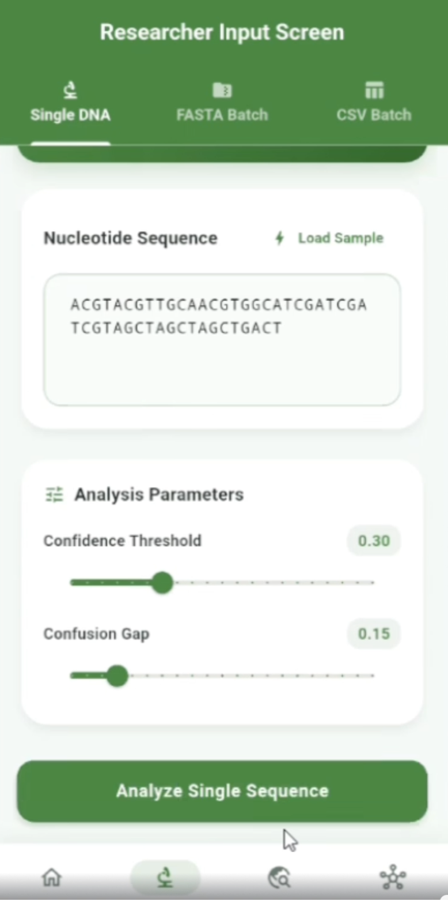
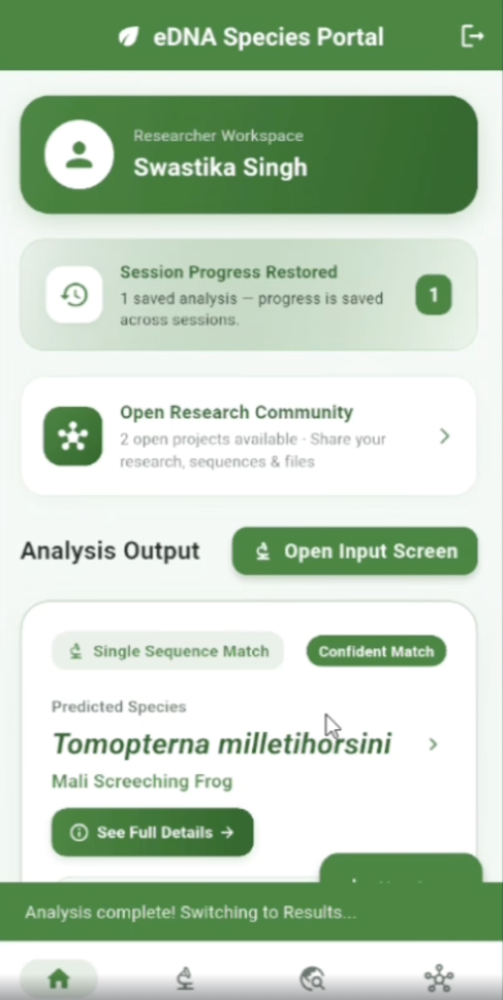
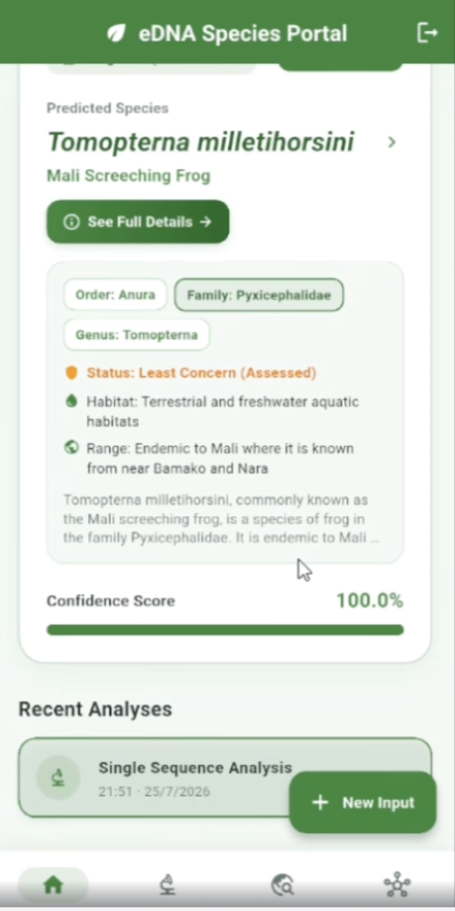
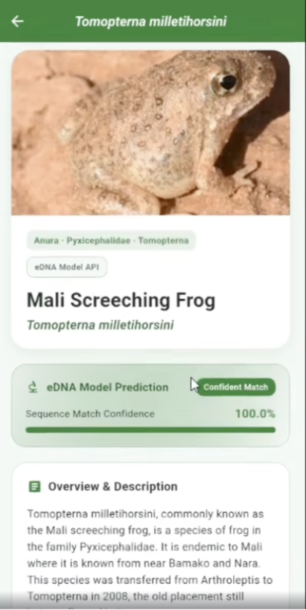

# edna_species_detection

**Identify amphibian species from environmental DNA (eDNA).** Give the system a raw DNA barcode
sequence and it returns the predicted species, a confidence score, and a species profile.

This repository contains the machine learning pipeline and the REST API. A mobile app built on
top of the API lets researchers run analyses and view results.

<p align="center">
  
  
  
  
</p>

## Features
- **Three input modes:** single sequence, FASTA batch, and CSV batch
- **Confidence-aware predictions:** if the top match is below a configurable confidence threshold,
  the API returns "Unknown" instead of guessing
- **Confusion detection:** when the top two species are too close, the result is flagged as
  confused and the top 5 candidates are returned
- **Species profiles:** common name, taxonomy, range, and description
- **Accuracy check on CSV batches:** compares predictions to known labels and reports accuracy

## How it works

| Step | Script | What it does |
|---|---|---|
| 1. Data | `filter_amphibia_chunked.py` | Streams the large BOLD COI database and extracts Amphibia sequences. Species with fewer than 5 sequences are dropped. |
| 2. Species info | `generate_species_descriptions.py` | Builds a species description dataset from GBIF and Wikipedia |
| 3. Training | `train.py` | Cleans placeholder labels (e.g. `Hylidae_XX`), converts each sequence to a 4-mer frequency vector (256 features), and trains a k-NN classifier (k = 5, cosine distance) |
| 4. Evaluation | `evaluate.py` | Reproduces the held-out test metrics and writes `eval_results.json` |
| 5. Serving | `app.py` | FastAPI backend that serves predictions and species info |

## Results

Evaluated on a held-out 20% test set (stratified split, seed 42). Run `python evaluate.py` to
reproduce; the full output is in `eval_results.json`.

| Metric | Value |
|---|---|
| Sequences / species | 9,380 / 674 |
| Train / test | 7,504 / 1,876 |
| Majority-class baseline | 1.66% |
| **Accuracy** | **90.46%** |
| Macro F1 | 0.869 |
| Weighted F1 | 0.894 |
| Top-5 accuracy | 96.86% |
| Genus-level accuracy | 96.64% |

**Confidence vs. coverage.** Confidence is the fraction of the 5 nearest neighbours that agree
on a species. A higher threshold means fewer predictions, but they are more accurate:

| Threshold | Coverage | Accuracy on covered |
|---|---|---|
| 0.3 | 99.2% | 91.1% |
| 0.6 | 96.4% | 93.0% |
| 0.8 | 89.3% | 96.1% |
| 1.0 | 75.6% | 98.5% |

**Accuracy by number of training samples per species**

| Train samples | Test samples | Accuracy |
|---|---|---|
| 1–4 | 125 | 86.4% |
| 5–9 | 493 | 90.3% |
| 10+ | 1,258 | 90.9% |

## Getting started

```bash
git clone https://github.com/ritikakatta24-beep/edna_species_detection.git
cd edna_species_detection
pip install -r requirements.txt

# Train the model (creates knn_species_model.joblib)
python train.py

# Reproduce the evaluation (creates eval_results.json)
python evaluate.py

# Start the API
uvicorn app:app --reload
```

Interactive API docs: `http://127.0.0.1:8000/docs`

To rebuild the dataset from scratch, download the BOLD files (`coidb.info.tsv` and
`coidb.clustered.fasta`) and run `python filter_amphibia_chunked.py`, then
`python generate_species_descriptions.py`.

## API reference

| Method | Endpoint | Description |
|---|---|---|
| POST | `/predict` | Predict species from one DNA sequence |
| POST | `/predict-batch` | Upload a FASTA file with multiple sequences |
| POST | `/predict-batch-csv` | Upload a CSV with columns `record_id`, `species`, `sequence`; returns per-row results and overall accuracy |
| GET | `/species` | List all species in the description database |
| GET | `/species/{name}` | Full details for one species |

**Example request**

```bash
curl -X POST http://127.0.0.1:8000/predict \
  -H "Content-Type: application/json" \
  -d '{"sequence": "ACGT...", "confidence_threshold": 0.3, "confusion_gap": 0.15}'
```

**Example response (shape)**

```json
{
  "predicted_species": "Tomopterna milletihorsini",
  "confidence": 1.0,
  "is_confident": true,
  "is_confused": false,
  "top_candidates": [],
  "species_details": { "common_name": "Mali Screeching Frog", "family": "Pyxicephalidae", "...": "..." }
}
```

## Limitations
- The test split is random, so near-identical sequences from the same species can appear in both
  train and test. Accuracy on genuinely new sequences or unseen species may be lower.
- The model only knows the 674 species it was trained on. Any input is matched to the closest
  known species, which is why the confidence threshold matters.
- Confidence is a neighbour-vote fraction, not a calibrated probability.
- Habitat and conservation status fall back to generic defaults when GBIF/Wikipedia have no
  data. They are not authoritative IUCN assessments.

## Tech stack
Python · scikit-learn · FastAPI · NumPy · pandas · Biopython · GBIF and Wikipedia APIs

